<!--
  Design system
  ─────────────
  Canvas  #07080D · Card #0D1018 · Line #1C2130
  Accent  #7C83FF → #38E1D0 (indigo → cyan)
  Type    Inter (display) · JetBrains Mono (labels)
  All visuals live in ./assets as hand-built SVGs, so nothing depends on third-party render services.
-->

  
  
  
  

 

<a href="#-"><picture>
  <source media="(prefers-color-scheme: light)" srcset="./assets/h-about-light.svg"/>
  
</picture></a>

I'm an Integrated B.Tech CSE (AI & Data Science) student at **MIT World Peace University, Pune** — and I care about the whole product, not just the model.

I train computer-vision models, build RAG assistants, and wrap them in full-stack platforms people actually use. Running teams and national-level events taught me the other half: scoping, coordinating and shipping on a deadline. That combination is why I'm heading toward **Technical Program Management**.

<table>
  <tr>
    <td width="25%" valign="top"><code>NOW</code> <b>Training YOLOv8</b> to find recyclable solar panels in e-waste</td>
    <td width="25%" valign="top"><code>FOCUS</code> <b>CV · RAG · Full-stack</b> models that ship inside real products</td>
    <td width="25%" valign="top"><code>ALSO</code> <b>Finance & Accounting</b> minor alongside the main degree</td>
    <td width="25%" valign="top"><code>OPEN TO</code> <b>Internships</b> collaborations and hackathon teams</td>
  </tr>
</table>

 

<a href="#-"><picture>
  <source media="(prefers-color-scheme: light)" srcset="./assets/h-impact-light.svg"/>
  
</picture></a>

 

<a href="#-"><picture>
  <source media="(prefers-color-scheme: light)" srcset="./assets/h-projects-light.svg"/>
  
</picture></a>

<table>
  <tr>
    <td width="50%" valign="top">
      <code>01 · CLUB PLATFORM</code>
      <h3>EMS — Election Management System</h3>
      
Election platform built and deployed in <b>4 days</b>, using a Modified Borda Count to keep ranked-choice results fair. Ran a live election with <b>50+ concurrent voters</b>.

      
    </td>
    <td width="50%" valign="top">
      <code>02 · BLOCKCHAIN · MRV</code>
      <h3>BluCarbon — Blue Carbon Registry</h3>
      
Registry and MRV platform for mangrove carbon credits, combining <b>Polygon</b>, <b>IPFS</b> and satellite/UAV imagery for verifiable credits and transparent monitoring.

      
    </td>
  </tr>
  <tr>
    <td width="50%" valign="top">
      <code>03 · CAPSTONE · HEALTH-AI</code>
      <h3>MediQ — AI Health Companion</h3>
      
Multilingual health platform with a <b>RAG diagnostic chatbot</b> and <b>DenseNet-121</b> image screening served via ONNX Runtime, inside a patient–doctor portal.

      
    </td>
    <td width="50%" valign="top">
      <code>04 · COMPUTER VISION · IN PROGRESS</code>
      <h3>SWIS — Solar Waste Identification</h3>
      
ML pipeline for a hardware device that detects recyclable solar panels in e-waste. Custom <b>YOLOv8</b> model on a merged Kaggle + UCI dataset, currently at <b>86% accuracy</b>.

      
    </td>
  </tr>
</table>

 

<a href="#-"><picture>
  <source media="(prefers-color-scheme: light)" srcset="./assets/h-experience-light.svg"/>
  
</picture></a>

 

<a href="#-"><picture>
  <source media="(prefers-color-scheme: light)" srcset="./assets/h-stack-light.svg"/>
  
</picture></a>

<table>
  <tr>
    <td width="22%"><code>LANGUAGES</code></td>
    <td></td>
  </tr>
  <tr>
    <td><code>WEB & BACKEND</code></td>
    <td></td>
  </tr>
  <tr>
    <td><code>AI / ML</code></td>
    <td></td>
  </tr>
  <tr>
    <td><code>DATA & CLOUD</code></td>
    <td></td>
  </tr>
  <tr>
    <td><code>ALSO</code></td>
    <td>YOLOv8 · RAG · Pinecone · ONNX Runtime · Polygon · IPFS · NextAuth.js · Zod · Canva</td>
  </tr>
</table>

 

<a href="#-"><picture>
  <source media="(prefers-color-scheme: light)" srcset="./assets/h-contact-light.svg"/>
  
</picture></a>

   
  Got a product idea, a hackathon team or an internship? I'd love to hear about it.
    
  <a href="mailto:samarthbolkotgi@gmail.com"><b>samarthbolkotgi@gmail.com</b></a>
  &nbsp;·&nbsp;
  <a href="https://www.linkedin.com/in/samarth-bolkotgi-a13b89344"><b>LinkedIn</b></a>
  &nbsp;·&nbsp;
  <a href="https://samarthbolkotgi.netlify.app"><b>Portfolio</b></a>
    
  <code>designed &amp; built by samarth — pune, india</code>

